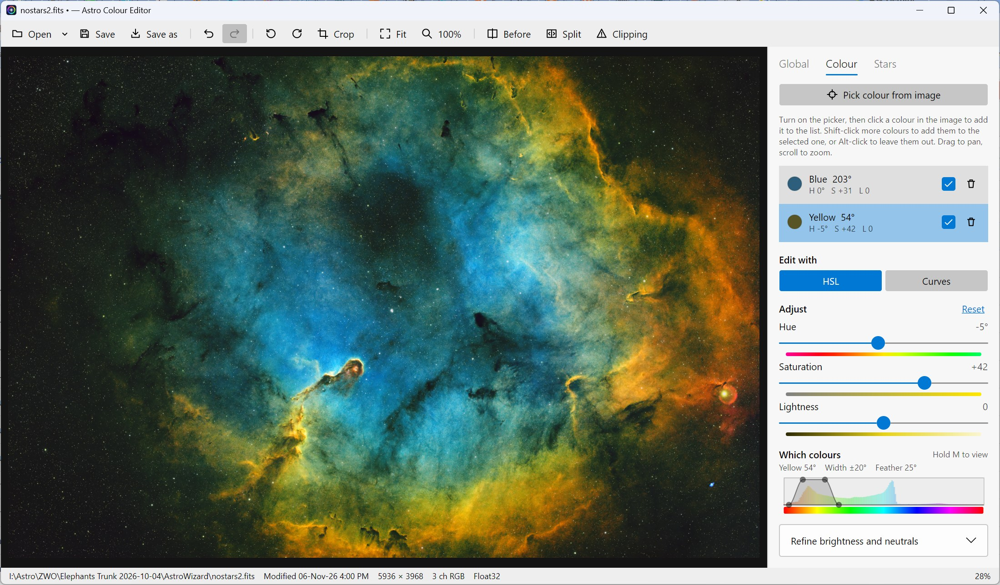

# Astro Colour Editor

A desktop tool for selective colour editing of `.xisf`, FITS, TIFF and camera raw images. It runs on Windows and macOS (Avalonia UI).



## Using it

Shortcuts below are for Windows; on a Mac use ⌘ in place of Ctrl.

1. **Open** (Ctrl+O) an `.xisf`, `.fits`, `.fit`, `.fts`, `.tif` or `.tiff` image, or pass a file path on the command line / drag it onto the exe
   (on a Mac: Finder's "Open With", or drop it on the Dock icon).
   Camera raw files (Nikon `.nef`/`.nrw`, Canon `.cr2`/`.cr3`, Sony `.arw`, Fuji `.raf`, Olympus `.orf`, Panasonic `.rw2`,
   Pentax `.pef`, Samsung `.srw` and `.dng`) open too, developed like a photo by [LibRaw](https://www.libraw.org/): camera
   white balance, sRGB, 16-bit, with no automatic brightening so highlights aren't clipped. The camera, exposure time,
   ISO, focal length, f-number and capture time become FITS keywords. A raw file can't be written, so saving always
   asks for a new file (TIFF by default). Raw files open on Windows and Linux; macOS needs LibRaw bundled (not done yet).
   The arrow beside **Open** lists the last ten files opened (also on the start screen, and under File > Open Recent
   on a Mac). File dialogs start in the open file's folder, or else the folder last opened from or saved to.
2. Turn on **Pick colour from image** (P) and click a colour in the image. A new entry appears in the list.
3. Under **Edit with**, choose **HSL** to adjust that colour's **Hue**, **Saturation** and **Lightness**, or
   **Curves** to shape its tones with RGB / Red / Green / Blue curves drawn over a histogram of just the selected
   colours. Similar hues are adjusted too, fading out smoothly. A colour can use both; curves apply after the HSL changes.
4. Refine which colours are affected under **Which colours**:
   - The hue band shows the selection over the image's hues. Drag its middle to move it, the top corners to set its
     width and the bottom corners to feather it; click elsewhere on the band to move it there, or double-click to reset.
   - **Shift-click** a colour in the image to add it to the selected entry, or **Alt-click** (Option-click on a Mac) to
     leave it out; the selection grows or shrinks on that colour's side.
   - The selected colours show (everything else greyed out) while you drag these controls, or while you hold **M**.
   - **Refine brightness and neutrals** (opened automatically when an entry uses it) has a brightness band that limits
     the selection to colours between a darkest and brightest luminance (how bright they look, so dim blue counts as
     dark), drawn over a histogram of the selected hue, and **Protect neutrals**, which leaves near-grey pixels
     (background, white stars) alone.
5. Pick more colours as needed. Each entry can be toggled or deleted, and you can double-click any slider (or its label) to reset it.
6. The **Global** tab edits the whole image:
   - **Narrowband normalisation** (colour images; applied first, before everything else) balances a narrowband
     image whose strong Hα signal swamps the other channels, after Bill Blanshan's PixelMath. Choose **SHO** (SII red,
     Hα green, OIII blue) or **HOO** (Hα red, OIII green and blue). As in PixInsight's NarrowbandNormalization (shadow point 1),
     the signal above each SII and OIII channel's median is stretched with a midtones transfer function so that its
     average positive deviation from the median matches Hα's; the background and anything darker are left alone.
     The statistics come from the full-resolution image. Then:
     **SII / OIII boost** multiply those channels; **Green reduction** applies SCNR (average neutral);
     **Lightness** keeps the normalised lightness, the **Original** lightness, or takes it from **Hα**.
     It works best on a starless image after background neutralisation and an unlinked stretch.
   - **Curves** (after the narrowband normalisation) shape the tones of the composite **RGB** curve or of the **Red**, **Green** and **Blue**
     channels over the image's histogram. Click to add a point and drag it; double-click, right-click or drag a point
     off the graph to remove it. Moving the end points sets the black and white points. Below the graph, the share
     of pixels the curves clip to black and to white is shown (for RGB, a pixel counts if any of its channels clips).
   - **Saturation** strengthens or mutes every colour in the image, after the curves.
   - **Remove purple** (0–1, after the saturation) moves green towards the average of red and blue with the pixel math
     `G: $T[1] + x * (($T[0] + $T[2]) / 2 - $T[1])`, turning purple (e.g. star halos) towards neutral.
   - **Hue curves** (after remove purple): **Hue vs hue** shifts each hue by up to ±90°, and **Hue vs saturation**
     mutes a hue to grey or doubles its saturation. Each starts flat with a point at red, yellow, green, cyan, blue
     and magenta; drag a point up or down, and the hues between follow smoothly round the circle. Click to add a point;
     double-click, right-click or drag a point off the graph to remove it. Behind the graph is the image's hue
     histogram, weighted by how colourful each pixel is.
   Curves also work on monochrome images (RGB curve only).

   The edits apply in this order: narrowband normalisation, curves, saturation, remove purple, hue curves, the colour editor,
   then stars. The colour editor's picker, its selected range and its curves' histogram see the image after
   the Global tab's edits.
7. On the **Stars** tab, **Add stars image…** loads a stars-only image (e.g. from StarXTerminator) the same size as
   the open (starless) image and adds it back with the pixel math `~((~starless) * (~(stars * x)))`. The
   **Star brightness (x)** slider (0–1) sets how bright the stars are. Stars go on after the colour editor and
   the Global tab's edits, are hidden by **Before**, and are blended into the saved image. A mono image takes the stars' luminance.
8. **Rotate left / right** (Ctrl+[ / Ctrl+]) turns the image 90° at a time; the rotation is applied when you save.
   A rotated image's astrometric solution (WCS keywords and PixInsight astrometry properties) no longer
   matches its pixels, so it is removed on saving — plate-solve the saved image again if you need one.
   **Crop** (C) shows a rectangle over the whole image: drag inside it to move it, drag an edge or corner to resize
   it, or drag outside it to draw a new one. **Aspect** keeps it to a shape (Original, 1:1, 4:3, 3:2, 16:9 and so on);
   **Reset** keeps the whole image. **Done** (or Enter, or C again) hides what is cropped away and fits the rest to
   the window. Like rotation, the crop is applied when you save, and Undo covers it. A cropped image keeps its
   astrometric solution: the WCS reference pixel (`CRPIX1`/`CRPIX2`) is moved by the amount cut from the left and,
   since FITS counts rows from the first one stored, from the top of a top-down FITS file or the bottom of a
   bottom-up one. XISF keywords are taken to count from the bottom, as PixInsight writes them. Distortion terms
   (SIP) are relative to the reference pixel, so they stay valid. PixInsight's own solution in an XISF file (the
   `AstrometricSolution:*` properties, which PixInsight 1.9 writes instead of WCS keywords) is moved too: the
   reference point and the image control points shift by the crop, and the projective transformations are composed
   with that shift. Its cached distortion grids (`PCL:AstrometricSolution:Grid:*`) are dropped for PixInsight to
   rebuild from the control points. Cropping and rotating together still drops the solution, keywords and
   properties alike.
9. **Before** (B) toggles the original image for comparison. **Split** (Y) shows the original left of a divider and the
   edited image right of it; drag the divider's handle to move it. The divider stays put while you zoom and pan.
   **Clipping** (J) paints the pixels your edits push to black in blue, those pushed to white in red, and those with
   channels pushed both ways in magenta, covering every edit (Global tab and colour editor). Channels that were already
   black or white in the original aren't marked, and neither are the stars, whose cores are meant to be white. The
   status bar shows the share of pixels clipped each way.
10. **Undo** (Ctrl+Z) and **Redo** (Ctrl+Shift+Z or Ctrl+Y) step through every edit since the file was opened: sliders,
    curves, picked colours, deletions, the Global and Stars tabs, and rotation. One slider drag or curve point drag is
    one step. Undoing back to the state last saved clears the unsaved-changes mark.
11. **Save** (Ctrl+S) overwrites the file after confirmation; **Save as** (Ctrl+Shift+S) writes a new file
    as XISF, FITS, TIFF, PNG or JPEG (the original's format is offered first). See [Saving in another format](#saving-in-another-format).

Navigation: scroll wheel (or trackpad pinch) zooms around the cursor, drag pans (right-drag also pans while the picker is on),
**Fit** (Ctrl+0) and **100%** (Ctrl+1).

On large images (longest side over 2400 px), the display uses a reduced-resolution preview while
a slider moves, then sharpens to full resolution once you stop. Saving always uses full resolution.

Colour editing is intended for stretched (non-linear) images; the app warns when an image looks linear.

## XISF support

- Reads monolithic XISF 1.0: UInt8/16/32 and Float32/64 samples, planar or normal pixel storage,
  attached / inline / embedded blocks, zlib, LZ4, LZ4HC and Zstandard compression, byte shuffling and sub-blocks.
- Edits the first image in the file.
- Saving keeps the original sample format and all header metadata (FITS keywords, properties, ICC profile,
  other attachments). The edited image is written uncompressed, and stale thumbnails are dropped.

## FITS support

- Reads the first image HDU (primary or IMAGE extension): 8/16/32-bit integer or 32/64-bit float, mono, or
  colour as three planes along `NAXIS3`. `BZERO`/`BSCALE` are applied; 16/32-bit data with the standard
  `BZERO` offset is treated as unsigned.
- Integer data is normalised by its type's range. Float data is taken as [0,1], or [0,65535] when its
  values go well above 1. NaN and infinite values are read as 0.
- `ROWORDER = 'BOTTOM-UP'` images are flipped for display; otherwise rows are shown as stored (top row first).
- Saving keeps the original sample format, scaling, row order, every header card and every other HDU.
  `CHECKSUM`/`DATASUM` are removed, since they would no longer match. Unedited, the file is written back byte for byte.
- Compressed (fpack `.fz`) images are not supported.

## TIFF support

- Reads the first image in the file: greyscale or RGB, optionally with extra channels such as alpha;
  8/16/32-bit integer or 16/32/64-bit float; contiguous or planar, stripped or tiled; any compression
  LibTiff.NET can decode (LZW, Deflate, PackBits, …) with horizontal or floating-point predictors.
- Integer data is normalised by its type's range; float data as for FITS. `MinIsWhite` images are inverted.
- Saving keeps the sample format, channel layout, compression (LZW if the original was lossy or exotic), predictor,
  resolution, orientation, ICC profile, XMP, IPTC and text tags. Images are written in strips. Further pages
  and EXIF data are not kept.
- Palette, CMYK and YCbCr images are not supported.

## Saving in another format

Saving in the format the image was opened from keeps all of its metadata, as described above. Save as in another
format writes a new file:

- **XISF, FITS, TIFF**: the original sample format is kept (Float16 TIFF becomes Float32; signed integers become
  unsigned). FITS and XISF carry the FITS keywords across (e.g. OBJECT, EXPTIME and the WCS); other metadata, such as
  XISF properties (including PixInsight's astrometric solution), ICC profiles and TIFF tags, is not converted.
  New FITS files are written top row first, without `ROWORDER`, and TIFF files are LZW-compressed.
  Between FITS and XISF the WCS counts pixel rows from opposite ends (a top-down FITS file from the top, PixInsight's
  XISF keywords from the bottom), so it is flipped to keep every pixel at the same sky position: `CRPIX2` becomes
  `height + 1 − CRPIX2`, the second column of the `CD` or `PC` matrix (or `CDELT2` if there is neither) changes sign,
  and so do the SIP terms that depend on an odd power of the y offset. A solution with `PV` distortion terms (such as
  TPV) can't be flipped that way, so it is dropped instead.
- **PNG**: 16-bit, or 8-bit if the original is 8-bit.
- **JPEG**: 8-bit, quality 95, without chroma subsampling.
- Extra channels such as alpha are dropped. PNG and JPEG files can't be opened in the editor; after saving one,
  **Save** keeps writing to it from the full-precision image, so repeated saves don't lose quality.

## Building

Requires the .NET 10 SDK.

```
dotnet run --project src/AstroColour.Desktop
dotnet test tests/AstroColour.Tests
```

To produce a self-contained Windows folder (`publish/win-x64`) you can copy to a PC without .NET installed:

```
dotnet publish src/AstroColour.Desktop -c Release -r win-x64 --self-contained -o publish/win-x64
```

To make a Mac app, run this on a Mac:

```
tools/package-macos.sh            # Apple Silicon; pass osx-x64 for Intel Macs
```

It writes `publish/macos-arm64/Astro Colour Editor.app` and a zip of it. Without signing settings the app is
only ad-hoc signed: it runs on the Mac that built it, but other Macs block it until it is opened with
right-click > Open. To distribute it, set `SIGN_IDENTITY` (a Developer ID certificate) and `NOTARY_PROFILE`
(a `notarytool` keychain profile); see the script's header.

`samples/MakeSample.cs` generates a synthetic test image: `dotnet run samples/MakeSample.cs`.

## Layout

- `src/AstroColour.Core`: XISF, FITS and TIFF readers/writers (`Xisf/XisfFile.cs`, `Fits/FitsFile.cs`, `Tiff/TiffFile.cs`),
  PNG and JPEG writers (`Png/`, `Jpeg/`, the latter using SkiaSharp), the camera raw reader (`Raw/RawFile.cs`, using LibRaw), format selection (`AstroImage.cs`) and the colour engine (`Colour/`), with no UI dependencies.
- `src/AstroColour.Desktop`: the Avalonia app (`macOS/` holds the app bundle's Info.plist and entitlements).
- `tests/AstroColour.Tests`: unit tests for XISF, FITS and TIFF decoding/encoding and the colour maths.
- `tools/make_icon.py`: draws the app icon (`src/AstroColour.Desktop/Assets/AppIcon.ico`, `.png` and `.icns`).
- `tools/package-macos.sh`: builds, signs and zips the macOS app bundle.

If the app crashes, details are written to `%LOCALAPPDATA%\AstroColourEditor\crash.log`
(`~/Library/Application Support/AstroColourEditor/crash.log` on a Mac).

## Third-party licences

Camera raw decoding uses [LibRaw](https://www.libraw.org/), licensed under LGPL 2.1 or CDDL 1.0, through the MIT-licensed
[Sdcb.LibRaw](https://github.com/sdcb/Sdcb.LibRaw) wrapper. LibRaw ships as a separate native library (`raw_r.dll`,
`libraw_r.so`) alongside the app.
